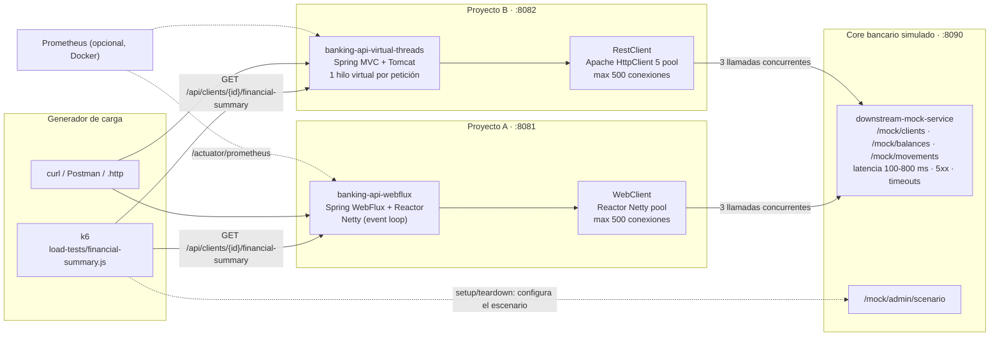
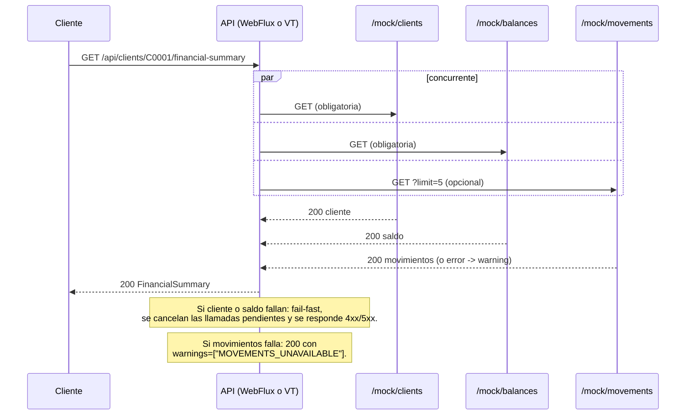

# Arquitectura del laboratorio

## Vista general



### Flujo de una petición (igual en ambas APIs)



## Módulos

| Módulo | Rol | Stack |
|---|---|---|
| `downstream-mock-service` | Simula el core bancario. Latencia uniforme configurable, errores 5xx y respuestas colgadas, en caliente vía `/mock/admin/scenario` o con IDs mágicos deterministas. | WebFlux (latencia con `Mono.delay`, sin bloquear hilos, para que el mock nunca sea el cuello de botella) |
| `banking-api-webflux` | Proyecto A. | Spring WebFlux, Reactor, `WebClient` sobre Reactor Netty |
| `banking-api-virtual-threads` | Proyecto B. | Spring MVC, Tomcat con `spring.threads.virtual.enabled=true`, `RestClient` sobre Apache HttpClient 5 |
| `contract-test-support` | Solo test. Core falso (`HttpServer` del JDK) + JSON de contrato esperados. Ambas APIs se prueban contra **los mismos ficheros**. | JDK puro, sin dependencias |
| `load-tests` | Scripts k6 y runner de comparación. | k6 |
| `observability/` (opcional) | Prometheus, Tempo y Grafana con dashboard aprovisionado. Ver `observability.md`. | Docker Compose |

**Por qué existe `contract-test-support`**: la petición pedía mantener separadas las dos implementaciones, y lo están (no comparten código de producción). Pero "mismo contrato" es una afirmación que conviene *probar*: los tests de ambas APIs comparan sus respuestas en modo `STRICT` contra los mismos ficheros (`contract-test-support/src/main/resources/contract/*.json`). Además, `scripts/compare-contracts.sh` compara byte a byte las dos APIs en vivo.

### Estructura de paquetes (idéntica en A y B)

```text
com.coffeecode.banking.{webflux|vt}
├── api/            Controller, DTO de respuesta, manejador de errores, filtro X-Implementation
├── client/         CoreBankingClient (HTTP), DTOs del core, traducción de excepciones
├── config/         DownstreamProperties, configuración del cliente HTTP y del pool
├── error/          ErrorCode, DownstreamException, ApiError (contrato de error)
├── service/        FinancialSummaryService (concurrencia) + SummaryAssembler (negocio puro)
├── health/         Health indicator "coreBanking"
├── demo/           Endpoints de demostración (solo con banking.demo.blocking-endpoints-enabled=true)
└── concurrency/    (solo VT) FailFastTasks
```

Los ficheros `error/*`, `client/CoreDtos`, `api/FinancialSummary`, `config/DownstreamProperties` y `service/SummaryAssembler` son **idénticos** entre A y B salvo el nombre del paquete. La diferencia entre los proyectos se concentra en cuatro ficheros, que son los que hay que comparar en la charla:

| Pieza | WebFlux | Virtual Threads |
|---|---|---|
| Concurrencia | `FinancialSummaryService` → `Mono.zip(...)` | `FinancialSummaryService` → `FailFastTasks` (`ExecutorCompletionService` + `Future`) |
| Cliente HTTP | `CoreBankingClient` → `Mono`/`Flux` | `CoreBankingClient` → valores directos |
| Pool / timeouts | `CoreBankingClientConfig` → `ConnectionProvider` + `HttpClient` de Reactor Netty | `CoreBankingClientConfig` → `PoolingHttpClientConnectionManager` + `RequestConfig` |
| Errores de I/O | `DownstreamErrors` → `ReadTimeoutException`, `PoolAcquireTimeoutException`... | `DownstreamErrors` → `SocketTimeoutException`, `ConnectionRequestTimeoutException`... |

## Contrato

`GET /api/clients/{clientId}/financial-summary`, con `clientId` que cumpla `^C\d{4}$`.

```json
{
  "clientId": "C0001",
  "fullName": "Ana Torres",
  "segment": "PREMIUM",
  "account": {
    "accountNumber": "0012-0001-123456",
    "currency": "COP",
    "availableBalance": 1520000.50,
    "ledgerBalance": 1600000.50,
    "heldAmount": 80000.00
  },
  "recentMovements": [
    {"movementId": "MV-0001-1", "bookingDate": "2026-10-01", "description": "Pago nómina", "amount": 4500000.00, "type": "CREDIT"}
  ],
  "warnings": []
}
```

Errores (`ApiError`): `{"status": 504, "code": "DOWNSTREAM_TIMEOUT", "message": "...", "path": "..."}`

| Situación | HTTP | `code` |
|---|---|---|
| `clientId` con formato inválido | 400 | `INVALID_CLIENT_ID` |
| Core responde 404 (cliente o saldo) | 404 | `CLIENT_NOT_FOUND` |
| Core responde 5xx u otro 4xx, o un JSON inválido | 502 | `DOWNSTREAM_ERROR` |
| Conexión rechazada, timeout de conexión o cierre prematuro | 503 | `DOWNSTREAM_UNAVAILABLE` |
| Sin conexión libre en el pool tras `pending-acquire-timeout` | 503 | `CONNECTION_POOL_EXHAUSTED` |
| Core no responde dentro de `response-timeout` | 504 | `DOWNSTREAM_TIMEOUT` |
| Fallo en movimientos (opcional) | 200 | — (`warnings: ["MOVEMENTS_UNAVAILABLE"]`) |
| Error no previsto | 500 | `INTERNAL_ERROR` |

Las respuestas de ambas APIs incluyen la cabecera `X-Implementation: webflux | virtual-threads`. Se usa una cabecera, y no un campo del JSON, para que los cuerpos sean idénticos.

## IDs mágicos del mock (deterministas)

| ID | Comportamiento | Resultado en las APIs |
|---|---|---|
| `C0001`–`C9999` | Datos generados de forma determinista a partir del ID | 200 |
| `C0404` | 404 en todos los endpoints | 404 `CLIENT_NOT_FOUND` |
| `C0500` | `/balances` responde 500 | 502 `DOWNSTREAM_ERROR` |
| `C0504` | `/balances` se cuelga 30 s | 504 `DOWNSTREAM_TIMEOUT` (a los ~2 s) |
| `C0599` | `/movements` responde 500 | 200 degradado con `warnings` |
| `C0800` | 1500 ms de latencia en todo | 200 lento (~1,5 s) |

Los scripts de carga solo usan IDs entre `C1000` y `C8999`, así que nunca activan estos casos por accidente.

## Comparabilidad

| Condición | Cómo se garantiza |
|---|---|
| Mismo contrato | Mismos fixtures en modo `STRICT` en los tests de ambas APIs, más `scripts/compare-contracts.sh` en vivo |
| Misma lógica de negocio | `SummaryAssembler` es idéntico en los dos proyectos |
| Mismo downstream y latencia | Ambas apuntan al mismo `downstream-mock-service`. k6 fija el escenario del mock en `setup()` |
| Mismos timeouts | `banking.downstream.*` con los mismos nombres y valores: connect 1 s, response 2 s, pool-acquire 1 s |
| Mismo pool | 500 conexiones máximo, cola de espera sin tamaño máximo y limitada por tiempo, sin reintentos automáticos |
| Misma política de concurrencia | 3 llamadas en paralelo, fail-fast con cancelación en las obligatorias y degradación en la opcional (verificado por tests en ambas) |
| Mismo manejo de errores | Mismo `ErrorCode` y `ApiError`, misma tabla de mapeo (tests con fixtures) |
| Misma JVM | Mismos flags: `-Xms512m -Xmx512m -XX:+UseG1GC` (plugin de Maven y scripts) |
| Misma observabilidad | Actuator con histogramas en `http.server.requests` y `http.client.requests`, y métricas del pool |

### Diferencias que **no** son del modelo de concurrencia (factores de confusión)

- **Servidor**: Netty frente a Tomcat. Tienen parsers HTTP, buffers y límites distintos (Tomcat: `max-connections` 8192 y `accept-count` 100; Netty no tiene un límite equivalente por defecto).
- **Cliente HTTP**: Reactor Netty frente a Apache HttpClient 5. Gestionan de forma distinta las conexiones ociosas: Netty detecta en el momento el cierre remoto de una conexión del pool, mientras que Apache solo lo descubre al reutilizarla (ver troubleshooting, caso 4).
- **Pila de filtros**: WebFilter frente a Servlet Filter, y DispatcherHandler frente a DispatcherServlet.
- **Detección de desconexión del cliente**: en WebFlux la desconexión cancela la cadena reactiva (y con ella las llamadas al core). En MVC, Tomcat no interrumpe el hilo de la petición; las llamadas al core siguen hasta que terminan o vence su timeout. En WebFlux se observó en las trazas (las tres llamadas se cortan en el mismo instante); ver `observability.md`.

## Versiones (verificadas el 2026-10-26)

| Componente | Versión | Fuente |
|---|---|---|
| Java | 25 (probado con Temurin 25.0.4+7 LTS) | `maven.compiler.release=25`, el enforcer exige ≥ 25 |
| Maven | 3.9.x (probado con 3.9.9) | el enforcer exige ≥ 3.9.0 |
| Spring Boot | **4.1.1** (GA del 2026-08-20) | parent POM |
| Spring Framework | 7.0.9 | gestionada por Boot |
| Reactor Core / Reactor Netty | 3.8.7 / 1.3.7 | gestionada por Boot |
| Netty | 4.2.x | gestionada por Boot |
| Tomcat embebido | 11.0.24 | gestionada por Boot |
| Apache HttpClient 5 / HttpCore 5 | 5.6.4 / 5.4.3 | gestionada por Boot |
| Jackson | 3.1.5 (`tools.jackson`) | gestionada por Boot |
| Micrometer | 1.17.1 | gestionada por Boot |
| JUnit Jupiter | 6.0.3 | gestionada por Boot |
| Micrometer Tracing / OpenTelemetry SDK | 1.7.1 / 1.62.0 | `spring-boot-starter-opentelemetry` (tracing apagado por defecto) |
| k6 | v2.3.0 (benchmark), v2.2.0 (instalado con winget) | binario externo |
| Grafana / Prometheus / Tempo (opcionales) | 13.2.4 / v3.13.4 / 2.10.10 | `docker-compose.yml` |

Spring Boot 4.1.2 se publicó el 2026-10-22. Se eligió 4.1.1 porque lleva dos meses publicada y es estable; para actualizar basta con cambiar la versión del parent. No se usa ninguna API preview de Java (ni `StructuredTaskScope` ni `ScopedValue`).

## Matriz comparativa: WebFlux frente a Virtual Threads

| Criterio | Spring WebFlux (Reactor) | Spring MVC + Virtual Threads |
|---|---|---|
| Modelo | Event loop con pocos hilos (≈ nº de cores) y callbacks/operadores | Un hilo (virtual) por petición y código secuencial |
| Estilo de código | Declarativo: `Mono`, `Flux`, `zip`, `flatMap` | Imperativo: `try/catch`, `for`, valores de retorno |
| Curva de aprendizaje | Alta (operadores, schedulers, contexto, depuración) | Baja: el Java de siempre |
| Stack traces / depuración | Fragmentados; hay que usar `checkpoint()` o `Hooks.onOperatorDebug()` | Lineales, con breakpoints normales |
| Coste de una espera de I/O | Ninguno: el hilo nunca espera | Muy bajo: el hilo virtual se aparca y el carrier se libera |
| Riesgo principal | Bloquear el event loop (JDBC, SDKs síncronos, `block()`, `Thread.sleep`) | Creer que hay recursos ilimitados (pools de BD/HTTP, rate limits del core) |
| Detección del riesgo | `block()` lanza excepción; `Thread.sleep` no avisa (BlockHound, thread dumps) | Métricas de pools y `jdk.VirtualThreadPinned` en JFR (raro desde Java 24) |
| Backpressure | Nativo (Reactive Streams) | No existe; hay que limitar a mano (semáforos, pools, colas) |
| Streaming (SSE, WebSocket, flujos largos) | Excelente | Posible, pero menos natural |
| Cancelación | Se propaga de forma automática (por ejemplo, cuando el cliente se desconecta) | Explícita (`Future.cancel(true)` → interrupción) |
| Composición de llamadas concurrentes | `Mono.zip`/`Flux.merge` | Executor + `Future`; `StructuredTaskScope` cuando deje de ser preview |
| Ecosistema bloqueante (JDBC, JPA, SDKs) | Hay que aislarlo en `boundedElastic` o usar alternativas reactivas (R2DBC) | Funciona tal cual |
| Contexto (MDC, seguridad, tracing) | Viaja en el Reactor Context de forma automática por la cadena; para los logs hace falta `spring.reactor.context-propagation=auto` | `ThreadLocal`: **no** viaja a los hilos que lances tú; hay que propagarlo (`ContextSnapshot`) o se rompen las trazas (verificado en el laboratorio) |
| Memoria por petición en espera | Estado en objetos/closures del pipeline | Pila del hilo virtual en el heap (crece con la profundidad de llamadas) |
| Cuándo elegirlo | Streaming, backpressure, equipos ya reactivos, gateways con mucha I/O y poca lógica | Servicios CRUD/orquestación, equipos imperativos, mucha lógica de negocio, dependencias bloqueantes |

**Ninguno de los dos acelera el core bancario.** Si el core tarda 600 ms, la API tarda como mínimo 600 ms. Lo que cambia es cuántas peticiones en espera puede sostener cada proceso con un uso razonable de memoria y CPU, y lo fácil que es escribir y mantener el código. Los límites reales los ponen el pool de conexiones, el propio core y la red.
