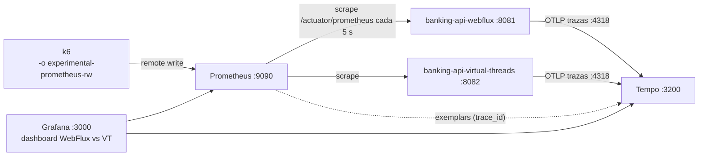

# Observabilidad: métricas y trazas en tiempo real (opcional)

Es un complemento **opcional** del laboratorio: necesita Docker. Sin Docker, todo lo demás funciona igual (Actuator, `/actuator/prometheus`, logs, k6 por consola).



| Componente | Versión | Rol |
|---|---|---|
| Grafana | 13.2.4 | Dashboard aprovisionado y exploración de trazas |
| Prometheus | v3.13.4 | Scrape de las APIs cada 5 s, receptor de *remote write* de k6, almacenamiento de exemplars |
| Tempo | 2.10.10 | Recibe trazas OTLP de las dos APIs |
| Spring Boot | `spring-boot-starter-opentelemetry` 4.1.1 | Micrometer Tracing 1.7.1 + OpenTelemetry SDK 1.62.0 + exportador OTLP |

## Puesta en marcha

```bash
# 1. Docker Desktop abierto y la pila levantada. La primera vez descarga las imágenes (~1,8 GB en disco,
#    sobre todo Grafana): hazlo ANTES de la charla, no con la Wi-Fi del evento.
docker compose up -d

# 2. APIs con tracing activo (perfil "observability"; se puede combinar con "demo")
PROFILE=observability ./scripts/start-all.sh                 # PowerShell: .\scripts\start-all.ps1 -SpringProfile observability
PROFILE=demo,observability ./scripts/start-all.sh            # charla: logs DEBUG + endpoints de demo + trazas

# 3. Calentar (importante, ver "Arranque en frío" más abajo) y lanzar carga enviando las métricas de k6 a Prometheus
export K6_PROMETHEUS_RW_SERVER_URL=http://localhost:9090/api/v1/write
export K6_PROMETHEUS_RW_TREND_STATS="p(95),p(99),avg"
k6 run -o experimental-prometheus-rw -e BASE_URL=http://localhost:8081 -e LABEL=webflux -e SCENARIO=warmup load-tests/financial-summary.js
k6 run -o experimental-prometheus-rw -e BASE_URL=http://localhost:8081 -e LABEL=webflux -e SCENARIO=high load-tests/financial-summary.js

# 4. Abrir http://localhost:3000 (sin login: es el dashboard de inicio)

# 5. Al terminar
docker compose down
```

En PowerShell, las variables de k6 se definen así: `$env:K6_PROMETHEUS_RW_SERVER_URL="http://localhost:9090/api/v1/write"; $env:K6_PROMETHEUS_RW_TREND_STATS="p(95),p(99),avg"`.

Sin `-o experimental-prometheus-rw` el dashboard funciona igual; solo queda vacía la fila "k6 (lado cliente)".

## El dashboard "Coffee Code #2 · WebFlux vs Virtual Threads"

Cada panel superpone las dos APIs con un color fijo: **WebFlux en azul y Virtual Threads en naranja**. Se refresca cada 5 s.

| Fila | Paneles | Qué enseñar |
|---|---|---|
| Petición de negocio | req/s · p95/p99 con **exemplars** · errores por status · **peticiones en vuelo** · hilos de plataforma · CPU | Con 300 req/s hay ~190 peticiones en vuelo (Ley de Little: 300 × 0,63 s; medido en el laboratorio: 190–194) y, aun así, solo unas decenas de hilos de plataforma en ambas |
| Core y pool | p95 de cada llamada al core · conexiones en uso (máx. 500) · llamadas esperando conexión | Al saturar, las conexiones se quedan planas en 500 y la cola crece **en las dos APIs a la vez**: el límite es el pool, no los hilos |
| JVM | heap · pausas de GC · asignación de memoria | Diente de sierra del GC. La diferencia entre modelos es pequeña |
| k6 | req/s · p95/p99 del cliente · tasa de errores | La latencia que percibe el usuario (incluye las colas) |
| Trazas | últimas trazas de `financial-summary` | Clic en un traceID → cascada de spans |

**Exemplars:** los puntos sobre las curvas de p95/p99 son peticiones concretas. Al pasar el ratón aparece el `trace_id`, y el enlace abre la traza en Tempo. Así se pasa de "el p99 subió" a "esta petición tardó 2 s porque *balances* hizo timeout".

Cosas que pueden confundir al leer el dashboard:
- `status="UNKNOWN"` en WebFlux son peticiones **canceladas** porque el cliente cerró la conexión (por ejemplo, k6 al terminar). Ver "Cancelación vista en las trazas".
- La serie de errores puede mostrar códigos con valor 0: son series de errores anteriores que siguen existiendo.
- El panel de peticiones en vuelo usa `http_server_requests_active_seconds_gcount`, sin filtrar por `uri`, porque al empezar la petición la plantilla de la URI todavía es `UNKNOWN`.

El JSON del dashboard (`observability/grafana/dashboards/webflux-vs-virtual-threads.json`) se genera con `python observability/grafana/generate-dashboard.py`. Grafana relee el fichero cada 10 s.

## Qué se ve en las trazas (verificado)

Una petición correcta tiene 4 spans: el del servidor y **tres hijos que empiezan en el mismo milisegundo**. Es la concurrencia, vista directamente:

```text
banking-api-webflux                      inicio   duración
  http get /api/clients/{clientId}/...   +0.0ms   780.4ms
    http get /mock/clients/{clientId}    +3.9ms   570.4ms
    http get /mock/balances/{clientId}   +5.9ms   751.1ms   <- la más lenta marca la latencia total
    http get /mock/movements/...         +7.1ms   131.3ms
```

**Fail-fast visto en las trazas** (VT, `C0500`: saldo responde 500):

```text
banking-api-virtual-threads
  http get /api/clients/{clientId}/...   +0.0ms   637.5ms   502
    http get /mock/balances/{clientId}   +1.6ms   622.6ms   500        <- falla
    http get /mock/clients/{clientId}    +1.6ms   626.3ms   cancelada  <- terminan a la vez: cancel(true)
    http get /mock/movements/...         +1.6ms   625.8ms   cancelada
```

**Cancelación vista en las trazas** (WebFlux, el cliente cortó la conexión): el span del servidor termina con `outcome=UNKNOWN` y **las tres llamadas al core terminan en el mismo instante (1942,7 ms)**. La cancelación se propagó hasta el core. En VT no se registró ninguna petición `UNKNOWN`: Tomcat termina la petición aunque el cliente ya no esté.

Peticiones para enseñarlo en directo: `C0001` (éxito), `C0500` (fail-fast), `C0504` (timeout a 2 s: el span de *balances* se corta), `C0599` (movimientos fallan → 200 degradado).

## La traza en WebFlux viaja sola; en Virtual Threads hay que llevarla

Este es el hallazgo más interesante de esta parte, y está cubierto por un test en cada API (`TracePropagationApiTest`):

- **WebFlux:** la observación actual viaja en el **Reactor Context**. `Mono.zip` y `WebClient` la heredan sin código adicional. Para que además los **logs** lleven `traceId`, el perfil activa `spring.reactor.context-propagation: auto`.
- **Virtual Threads:** la observación vive en un **ThreadLocal** del hilo virtual de la petición. `FailFastTasks` lanza cada llamada en *otro* hilo virtual, y los ThreadLocal no viajan solos. Sin hacer nada, **cada llamada al core iniciaba una traza nueva y huérfana**. El test lo detectó (tres traceIds distintos en lugar del de la petición):
  ```text
  ["00-a04b7f17580aea6f424aca40bc93ba7c-...", "00-269aafb55be156a9348dce20e3a3c7ff-...", "00-04b321731a9560f398ed1a04556a3db2-..."]
  ```
  Solución, en una línea de `FailFastTasks.fork()`:
  ```java
  Callable<Object> withContext = CONTEXT.captureAll().wrap(task::call);   // io.micrometer.context.ContextSnapshotFactory
  ```
  Lo mismo pasa con el MDC, el contexto de seguridad o cualquier otro ThreadLocal, y con *cualquier* executor propio (no solo con hilos virtuales). Los `ScopedValue` (JEP 506, definitivos en Java 25) resolverán esto de forma nativa junto con `StructuredTaskScope` cuando este deje de ser preview.

Con tracing activo, los logs de las dos APIs incluyen `[traceId-spanId]`, que sirve para buscar la traza en Tempo:
```text
WARN ... [mcat-handler-99] [4c99c5d5a7672ac4118040d2cbe69e11-809ba55b7f5ab4fe] c.c.banking.vt.api.GlobalErrorHandler : ... -> DOWNSTREAM_TIMEOUT
```

## Decisiones de diseño

- **Tracing apagado por defecto** (`management.tracing.export.enabled=false`): ni se crean ni se propagan trazas, y el benchmark no paga su coste. El perfil `observability` lo activa con un muestreo del 100 % (adecuado para una demo; en producción se muestrea un porcentaje).
- **Sin push OTLP de métricas** (`management.otlp.metrics.export.enabled=false`): el starter de OpenTelemetry incluye `micrometer-registry-otlp`, que por defecto intenta enviar métricas a `localhost:4318` cada minuto. Las métricas ya llegan por scrape.
- **`/actuator` fuera de las observaciones** (`ObservationConfig` en cada API): el scrape de Prometheus cada 5 s y los health checks llenaban Tempo de trazas sin interés.
- **Tempo 2.10** y no 3.x: la 3.x se publicó semanas antes de crear el laboratorio y es una versión mayor; la 2.10 sigue recibiendo parches.
- **Sin Loki ni logs centralizados:** en 30 minutos no aportan más que la consola, y el `traceId` en el log ya sirve para pasar a la traza.
- **Acceso anónimo como admin en Grafana:** solo para la demo local. Nunca así fuera de `localhost`.

## Problemas encontrados al montarlo

| Síntoma | Causa | Solución |
|---|---|---|
| Cada llamada al core de VT era una traza separada | ThreadLocal no viaja a los hilos de `FailFastTasks` | `ContextSnapshot` en `fork()` (con test) |
| Tempo lleno de trazas `GET /actuator/prometheus` | Prometheus hace scrape cada 5 s | `ObservationPredicate` |
| "Peticiones en vuelo" sin datos | Con histogramas, el *long task timer* se publica como `_gcount` y con `uri="UNKNOWN"` | Consulta sobre `http_server_requests_active_seconds_gcount` sin filtro de `uri` |
| Latencia de k6 en el panel ~1000 veces menor | k6 publica las tendencias en **segundos** | Unidad `s` en el panel |
| 13–16 % de `Connection refused` al lanzar las dos APIs a la vez | Arranque en frío: los dos pools vacíos abren cientos de conexiones al mock en el mismo segundo | **Calentar antes** (`SCENARIO=warmup`). Con los pools calientes: 0 % de errores. Ver troubleshooting, caso 1 |
| Grafana mostraba una versión vieja del dashboard | Se había cargado antes de regenerar el JSON | `updateIntervalSeconds: 10` en el *provider* |
| Tempo devuelve traceIDs de 31 caracteres | La API de búsqueda quita los ceros iniciales | Rellenar con ceros a la izquierda al construir URLs |

## Impacto en el benchmark

Las cifras de `benchmark-guide.md` se midieron **antes** de añadir el tracing, con la configuración por defecto. Con el perfil por defecto, el tracing está desactivado. El código nuevo que se ejecuta en cada petición se limita a la captura de contexto en `FailFastTasks` y al `ObservationPredicate`, y no se espera que cambie los resultados, pero **no se ha vuelto a medir**. Para comparar con tracing activo, hay que activarlo **en las dos APIs**: cada modelo tiene un coste de instrumentación distinto, y comparar una instrumentada con otra sin instrumentar no es justo.
